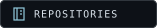
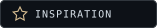

  

  
  &nbsp;
  

 

<h3 align="center">✦ &nbsp; About me</h3>

Hey, I'm **Karlygash** 👋

Welcome to my little corner of GitHub — a space for ideas, experiments, and things worth building.

I like the idea of making something a little better with every iteration.

**Stay curious. Build with intention. Keep improving.**

 

<!-- PERSONALIZE: Add your focus and what you are currently learning
     to the introduction above. Add only real details. -->

---

<h3 align="center">⌘ &nbsp; Around here</h3>

<table>
  <tr>
    <td width="50%" valign="top">
      <h4>01 / The workshop</h4>
      
Code, projects, and work in progress.

      <a href="https://github.com/a1ksh?tab=repositories">Explore repositories →</a>
    </td>
    <td width="50%" valign="top">
      <h4>02 / The inspiration shelf</h4>
      
Interesting tools and ideas from the community.

      <a href="https://github.com/a1ksh?tab=stars">Explore starred projects →</a>
    </td>
  </tr>
</table>

<!-- TECHNOLOGIES: Add a centered row of badges for the languages and
     tools you actually use. No stack has been assumed in this draft. -->

<!-- SELECTED WORK: Replace or extend the workshop section with your
     2–3 best projects, a one-sentence description, and a demo link. -->

 

  <code>while (curious) { keepBuilding(); }</code>

Thanks for stopping by. See you in the next commit.

